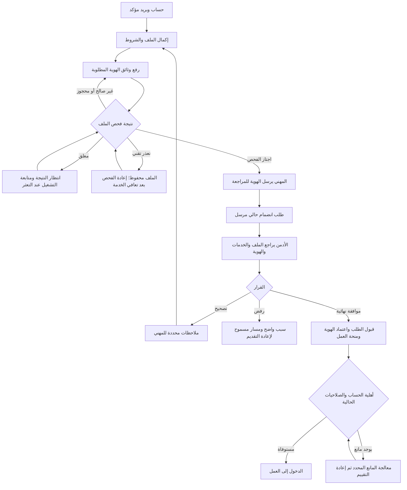

# رحلة المهني: من إنشاء الحساب إلى السماح باستقبال العمل

## نطاق هذا الدليل

هذا دليل تشغيل واختبار للتصحيح المؤرخ في 11 نوفمبر 2026. يشمل تأكيد البريد،
اكتمال الملف، رفع وثائق الهوية وفحصها، إرسالها للمراجعة، قرار طلب الانضمام،
وصلاحيات العمل الفعلية. الفرع هو
`fix/provider-verification-journey-20261111`. يسجل طلب الدمج رقم النسخة النهائي
ونتائج الاختبارات؛ لا يثبت هذا الدليل أن جهاز المستخدم أو الإنتاج يعمل بتلك النسخة.

الصور المبلغ عنها تثبت أن وثيقة وصلت وأن فتحها محجوب أثناء انتظار الفحص، لكنها
لا تثبت أن خدمة الفحص تعمل. كذلك لا يكفي ظهور «الهوية موثقة» لإثبات قبول طلب
الانضمام أو امتلاك صلاحية استقبال العمل. لكل مرحلة قرارها وسبب منعها.

## 1. المسار المعتاد بخطوات واضحة

### ما يفعله المهني

1. ينشئ حسابًا ويؤكد بريده بالطريقة المتاحة. عند انتهاء تحدي الرمز يستخدم مسار
   الاستعادة المبين في الشاشة؛ لا يكرر إعادة إرسال التحدي غير الصالح بلا نهاية.
2. يكمل البيانات الأساسية، الخدمات والخبرة، منطقة العمل، أوقات العمل، وما تطلبه
   سياسة التسجيل. يراجع الشروط الحالية ويوافق عليها. الصورة الشخصية مستقلة
   عن وثيقة الهوية، ولا تقوم مقامها.
3. يفتح «توثيق الهوية والمؤهلات». يمكنه بدء رفع المستندات في مرحلة إعداد الملف
   عندما يمنحه الخادم صلاحية إدارة التوثيق؛ لا يشترط منحه صلاحية العمل أولًا.
4. يختار «ابدأ التوثيق» ثم «إضافة مستند» عندما تكون هذه هي الخطوة التي يسمح بها
   وضعه الحالي. يحدد النوع المطلوب ويرفع PDF أو JPEG أو PNG وفق حدود الخادم.
5. ينتظر اكتمال الفحص. «مستلمة» تعني وصول الوثيقة، و«بانتظار فحص الأمان» تعني
   أن صلاحيتها للفتح لم تثبت بعد. لا تعني أي منهما توثيق الهوية.
6. بعد اجتياز الوثائق المطلوبة للفحص، واستكمال شروط الملف، يضغط **«إرسال
   للمراجعة»**. هذا إجراء مستقل وصريح؛ رفع الملف أو تحديث الصفحة لا يرسل القضية.
7. يرسل طلب الانضمام إذا لم يكن مرسلًا. وإذا أعيد سابقًا للتصحيح، يراجع الملاحظات
   ويعيد إرسال الطلب من مساره؛ توثيق الهوية لا يعيد إرسال طلب قديم تلقائيًا.
8. يتابع «حالة حسابك». تعرض الصفحة الإجراء المتبقي وصاحبه. بعد اكتمال قرار
   الأدمن واستيفاء شروط الخادم، تعرض الدخول إلى مساحة العمل.

يمكن أن يصل طلب الانضمام إلى الأدمن قبل انتهاء توثيق الهوية. هذه حالة مسموحة،
لكن القرار النهائي يظل محجوبًا حتى تكتمل متطلبات المراجعة الحالية.

### ما يفعله الأدمن

1. يفتح ملف المهني من دليل المهنيين، ويتأكد من **نسخة الطلب المرسلة الحالية**.
   تعرض الصفحة سبب التعثر والخطوة التالية بدل إخفاء كل المعلومات عند غياب القرار.
2. يراجع أقسام الملف والخدمات. صحة البيانات في كل قسم لا تساوي تلقائيًا قبول
   الطلب كله. قرار التخصصات/الخدمات له متطلباته المستقلة.
3. في قسم الهوية، يقرأ حالة الوثيقة والقضية. إذا كانت القضية مسودة نظيفة، يطلب
   من المهني **إرسالها للمراجعة**. إذا كان الفحص معلقًا، ينتظر النتيجة أو يحيل
   التعثر التقني إلى التشغيل؛ زر عرض الوثيقة لا يشغّل مكافحة البرمجيات الخبيثة.
4. عندما يسمح الخادم، يختار **«عرض الوثيقة للمراجعة»** ويفحص وضوحها وملاءمتها
   ومطابقة البيانات المطلوبة. لا يفتح النظام ملفًا غير مجتاز للفحص لإرضاء هذه الخطوة.
5. إذا كانت البيانات صحيحة وكل الشروط متحققة، يستخدم **الموافقة النهائية على
   طلب الانضمام** من لوحة القرار، ثم يؤكد القرار.
6. ينفذ الخادم الموافقة المتكاملة داخل معاملة واحدة: قبول الطلب، تفعيل ملف
   المهني، اعتماد الهوية عندما تتطلب الحالة ذلك، وإنشاء منحة العمل المرتبطة
   بالوثائق المعتمدة، مع سجل التدقيق والأحداث اللازمة.
7. يتحقق من النتيجة في «الصلاحيات الحالية». الأزرار المتاحة للمهني تُبنى على
   صلاحيات الخادم الفعلية، لا على لون شارة الهوية وحده.

المسار المعتاد لا يتطلب اختراع زر ثانٍ لتجاوز المتطلبات. إذا كانت الهوية قد
اعتمدت مسبقًا، يحافظ القرار النهائي على ذلك القرار والمنحة الصالحة، ولا يصنع
قرار هوية مكررًا. أما اعتماد الهوية من شاشة القضايا المستقلة فلا يقبل تلقائيًا
طلب انضمام معادًا للتصحيح أو غير مرسل.

## 2. مخطط الرحلة



هذا مخطط المسار المعتاد. عند طلب تعديل للملف فقط، لا نعيد المهني قسرًا إلى رفع
هوية معتمدة. وعند وجود قضية مرسلة لا يمكن للمهني تبديل وثائقها حتى يطلب المراجع
تعديلًا يسمح به الخادم. جدول الحالات التالي يضبط هذه الفروع.

## 3. الحالات المستقلة التي يجب قراءتها

| المحور            | السؤال الذي يجيب عنه                                      | ما لا يثبته بمفرده                       |
| ----------------- | --------------------------------------------------------- | ---------------------------------------- |
| الحساب والبريد    | هل الجلسة والحساب مؤهلان للدخول؟                          | اكتمال الملف أو قبول العمل               |
| طلب الانضمام      | هل توجد نسخة حالية مرسلة؟ وهل قبلت أم أعيدت؟              | سلامة ملف الهوية                         |
| فحص الوثيقة       | هل اجتاز هذا الملف التحقق البنيوي وفحص البرمجيات الخبيثة؟ | أن الشخص صاحب الهوية أو أن الوثيقة أصلية |
| قضية الهوية       | هل أرسل المهني الوثائق؟ وهل اتخذ المراجع قرارًا؟          | قبول طلب انضمام منفصل                    |
| منحة العمل        | هل توجد منحة فعالة بالمصدر والمدة الصحيحين؟               | أهلية حساب موقوف أو طلب غير مقبول        |
| الصلاحيات الفعلية | ما العمليات التي يسمح الخادم بها الآن؟                    | ترخيص مهني حكومي خارج نطاق المنصة        |

قرارات الخادم هي المرجع. إعدادا `VERIFICATION_ENFORCED` و`WORK_ACCESS_ENFORCED`
افتراضيًا `false` في مخطط الإعدادات الحالي لأسباب توافق الإصدارات السابقة.
قد تتجاوزهما إعدادات البيئة. لا يغير هذا التصحيح قيمهما ضمنيًا، ولا يمكن استنتاج
قيم الإنتاج من قيمة المصدر. اختبارات الرحلة المقيدة تفعلهما صراحة في بيئة اختبار
معزولة لتثبت منع العمل حتى اكتمال الشروط.

## 4. حالات الملف الأمني

| الحالة                           | المعنى                                   | من يتصرف؟                     | الإجراء الصحيح                                                                                    |
| -------------------------------- | ---------------------------------------- | ----------------------------- | ------------------------------------------------------------------------------------------------- |
| لا وثيقة مطلوبة مرفوعة           | ما زال هناك متطلب ناقص                   | المهني                        | يضيف الوثيقة المطلوبة من شاشة التوثيق، لا من الصورة الشخصية                                       |
| `PENDING`                        | وصل الملف ولم تكتمل نتيجة الفحص          | عامل الفحص/التشغيل            | انتظار النتيجة؛ تحديث بيانات الحالة؛ معالجة الخدمة إذا استمر التعثر                               |
| `CLEAN`                          | اجتاز الملف الفحوص المحددة               | المهني أو المراجع بحسب القضية | إرسال المسودة للمراجعة، أو مراجعة الملف المرسل؛ لا موافقة تلقائية                                 |
| `SCAN_FAILED`                    | لم يستطع النظام إكمال الفحص لأسباب تقنية | التشغيل وعامل الفحص           | يحتفظ بالملف ويعيد فحصه بعد مهلة المحاولة وتعافي الخدمة؛ لا يطالب المهني برفعه مجددًا لمجرد العطل |
| `QUARANTINED`                    | نتيجة تقييد بسبب اكتشاف تهديد            | المهني بعد السماح بالتعديل    | لا فتح ولا تنزيل؛ استبدال الملف عبر المسار المسموح                                                |
| `REJECTED` للملف                 | فشل التحقق من نوع/بنية الملف             | المهني بعد السماح بالتعديل    | رفع ملف صحيح وفق النوع والحجم والاكتمال المطلوب                                                   |
| وثيقة مستبدلة أو منتهية الاحتفاظ | ليست دليلًا حاليًا صالحًا للقرار         | النظام/المراجع                | عرضها كسجل عند السماح بذلك؛ لا استعمالها بدل المتطلب الحالي                                       |

تبقى القراءة والإرسال المقيد محجوبين للوثيقة التي تحتاج نتيجة ناجحة. إذا كانت
الوثيقة المتعثرة **اختيارية** والقضية مرسلة أصلًا، يبقى المراجع صاحب الخطوة
التالية؛ لا تقول الواجهة للمهني أن يرفع ملفًا وهو غير مخول بالتعديل.

وفي المسودة أيضًا، لا تمنع وثيقة اختيارية متعثرة إرسال القضية عندما تكون جميع
المتطلبات المطلوبة مستوفاة ويتيح الخادم الإرسال. يظل الملف الاختياري نفسه
غير قابل للفتح. تطابق المتطلبات نوع المستند وتخصصه؛ لا يعوض ترخيص تخصص آخر
عن الترخيص المطلوب، ولا تكفي نسخة نظيفة سابقة إذا كانت مستبدلة.

تحديث الواجهة دوريًا يجلب النتيجة فقط. لا يشغّل الفحص ولا يجعل ملفًا `CLEAN`.
إذا كانت الخدمة معطلة، فلن تعالج كثرة الضغط على «تحديث» سبب العطل.

## 5. حالات قضية الهوية وطلب الانضمام

| الحالة                                             | الخطوة التالية وصاحبها                                          | ما تمنعه الواجهة والخادم                            |
| -------------------------------------------------- | --------------------------------------------------------------- | --------------------------------------------------- |
| لا ملف مهني                                        | المهني يكمل التفعيل/إنشاء الملف                                 | طلب وثائق خاصة قبل امتلاك صلاحية إدارتها            |
| ملف مسودة مع صلاحية إدارة الهوية                   | المهني يستطيع بدء التوثيق ورفع المستندات                        | اشتراط قبول العمل قبل السماح بالرفع                 |
| `DRAFT` بلا مستندات                                | المهني يضيف المطلوب                                             | عرض «انتظر المراجعة» مع أن شيئًا لم يرسل            |
| `DRAFT` وفحوص معلقة أو متعثرة                      | متابعة نتيجة الفحص أو إصلاح خدمته                               | فتح الوثيقة أو إرسال متطلب غير مجتاز                |
| `DRAFT` والمطلوب جاهز                              | المهني يختار «إرسال للمراجعة»؛ يعالج أي نقص في بياناته أو شروطه | إرسال تلقائي أو قرار أدمن على قضية غير مرسلة        |
| `SUBMITTED`                                        | المراجع يفحص ويتخذ القرار المسموح                               | استبدال المهني للدليل أثناء المراجعة                |
| `IN_REVIEW`                                        | المراجع يكمل المراجعة                                           | إظهار رفع جديد بوصفه خطوة المهني التالية            |
| `ACTION_REQUIRED`                                  | المهني يقرأ الملاحظات، يعدل المسموح ويعيد إرسال الهوية          | استمرار قرار قديم كأنه ينطبق على نسخة معدلة         |
| `VERIFIED` والطلب لم يرسل أو أعيد                  | المهني يكمل/يعيد إرسال طلب الانضمام، ثم الأدمن يقرر             | الادعاء بأن توثيق الهوية فعّل طلب الانضمام          |
| `VERIFIED` والطلب الحالي منتظر                     | الأدمن يكمل قرار الطلب إذا استوفت بقية الشروط                   | مطالبة المهني برفع هوية إضافية بلا متطلب            |
| `VERIFIED` وطلب مقبول ومنحة صالحة وحساب مؤهل       | الدخول إلى مساحة العمل                                          | استمرار رسالة عامة تمنع العمل بلا بيان سبب          |
| `VERIFIED` دون منحة عمل فعالة وصلاحية العمل محجوبة | التشغيل/المراجع يفحص السبب وسجل المنحة والمسار النظامي          | منح صلاحية من الواجهة أو التحايل برفع وثيقة إضافية  |
| `REJECTED` أو `EXPIRED` للقضية                     | بدء قضية جديدة عندما تسمح سياسة الإنشاء؛ ثم رفع وإرسال ومراجعة  | إحياء القرار النهائي القديم بتعديل محلي             |
| أكثر من قضية مفتوحة على نحو غير متسق               | معالجة التعارض لدى التشغيل                                      | اختيار قضية عشوائية أو إنشاء قضايا مكررة            |
| حساب موقوف أو مقيد أو منتهي                        | صاحب الصلاحية يعالج إجراء الحساب ضمن مساره                      | تجاوز الإيقاف لأن الهوية صحيحة                      |
| سحب الطلب للتعديل                                  | المهني يعدل ثم يرسل نسخة حالية جديدة                            | استخدام نسخة سحبها المهني لمنح الموافقة             |
| تغير الملف بعد الإرسال                             | طلب إعادة إرسال وفق موانع الخادم                                | موافقة صامتة على لقطة لم تعد تمثل البيانات المطلوبة |
| فشل تحميل أو تعارض `409`                           | تحديث ناجح ومراجعة الحالة ثم اختيار قرار جديد                   | استعمال صلاحيات مخبأة أو إحياء نافذة تأكيد قديمة    |

تسمح سياسة إنشاء القضية باستئناف القضية المفتوحة الوحيدة، وتمنع إنشاء أخرى
عند وجود هوية موثقة. بعد الرفض النهائي أو انتهاء الصلاحية يمكن بدء قضية جديدة
وفق الشروط. الطلب المكرر بالمفتاح نفسه يعيد العملية الأصلية بدل تكرارها.

أي منحة مستقلة أو استثناء إداري يخضع لصلاحياته وسياساته وسجله؛ هذا التصحيح لا
يضيف تجاوزًا عامًا باسم «تفعيل». في حالة بيانات قديمة غير متسقة، يجب تحديد
السبب قبل اختيار إصلاح البيانات أو إعادة التحقق النظامية.

## 6. ما أصلحناه في هذا التغيير

| العيب المثبت                                                     | الإصلاح                                                                               |
| ---------------------------------------------------------------- | ------------------------------------------------------------------------------------- |
| مركز الحالة يختزل كل قضية `DRAFT` في «لم يبدأ»                   | يعتمد حالة الوثائق نفسها: رفع مطلوب، انتظار فحص، تعثر تقني، أو جاهز للإرسال           |
| مهني أمام عبارة انتظار بينما عليه إرسال المسودة النظيفة          | تظهر دعوة مباشرة إلى متابعة التوثيق ثم الإرسال الصريح                                 |
| `SCAN_FAILED` يعامل كأنه ملف غير آمن يستلزم الاستبدال            | حالة تقنية مستقلة تحفظ الملف وتتيح متابعة إعادة الفحص؛ يظل الملف محجوبًا حتى النجاح   |
| شاشة هوية موثقة لا توصل إلى طلب انضمام معاد                      | توضح العمل المتبقي على الطلب، وتتيح مسار المتابعة المسموح                             |
| عبارة «فحص آمن» وزر «فحص الوثيقة» يوحيان بأن الأدمن يشغّل ماسحًا | تسميات واضحة: وصول مقيّد، وعرض الوثيقة للمراجعة                                       |
| غياب أزرار القرار يترك الأدمن بلا تفسير                          | لوحة خطوة تالية تحدد صاحب الإجراء والمانع؛ تفرق بين الرفع والفحص والإرسال والمراجعة   |
| ذاكرة تفاصيل الأدمن قد تبقي صلاحيات قديمة خمس دقائق              | قراءة حديثة عند الدخول؛ توقف الأوامر أثناء الفشل أو التعارض                           |
| تأكيد قرار قد ينتقل من القضية أ إلى ب                            | تثبيت هوية القضية وحالتها وإجراءها في نية القرار؛ إعادة ضبط اللوحة عند التبديل        |
| تحديث ناجح قد يعيد تمكين تأكيد قديم بعد تغير التفاصيل            | إصدار محلي للمراجعة يبطل النية السابقة، مع إبقاء الملاحظات المتاحة للمراجعة           |
| ضغط تأكيد متكرر يطلق أوامر متوازية                               | حاجز متزامن يمنع إرسال قرار آخر أثناء الطلب الجاري                                    |
| ملفات فشل فحصها تتكرر دون تحديث وقت المحاولة                     | تحديث وقت اكتمال إعادة المحاولة بشرط تنافس يحمي النتيجة الأحدث                        |
| الدفعة البطيئة تعيد تقديم أقدم إخفاقات وتحجب ملفات أخرى          | ترتيب الملفات غير المجربة أولًا، ثم الأقل حداثة في المحاولة، مع ترتيب ثابت            |
| رد ماسح يحتوي كلمة `OK` قد يفسر كنجاح                            | قبول الرد الإيجابي المحدد `stream: OK` مع إنهاء NUL فقط                               |
| رد ماسح طويل أو بطيء قد يستهلك الذاكرة أو يعلق الدفعة            | حد 4 KiB للرد ومهلة مطلقة، مع الفشل المغلق عند مخالفة البروتوكول                      |
| خطأ رمز البريد المنتهي يدعو إلى تكرار إعادة الإرسال              | رسائل عربية/إنجليزية ومسار استعادة للتحدي غير القابل للمتابعة، دون تغيير حدود الحماية |

أثبتت اختبارات الرجوع فشل حالات جديدة على التنفيذ السابق ثم نجاحها بعد الإصلاح.
لا تعني هذه النتيجة أن النظام خالٍ من كل عيب محتمل. لا يغير الإصلاح قاعدة البيانات
أو المخططات أو كلمات المرور أو الأدوار أو قيم فرض التوثيق والمنح ضمنيًا.

ترتيب الفحص الجديد يعالج دوران الإخفاقات في الدفعات المحدودة. لا يغني عن مراقبة
قدرة خدمة الفحص عند زيادة الرفع، وقد يتطلب ترتيبًا إضافيًا في استعلام قاعدة
البيانات لأن الفهرس الحالي ليس مطابقًا بالكامل لهذا الترتيب. قياس خطة التنفيذ
والقدرة تحت أحمال الإنتاج مستقل عن إثبات صحة الانتقال.

## 7. كيف يحمي النظام فتح المستند؟

تبدأ الحماية قبل العرض: قائمة أنواع محددة، حجم فعلي مقيد، فحص توقيع البداية
ومطابقته لنوع الملف واسمه، ثم تحقق من اكتمال البنية الأساسية. لا تكفي تسمية
ملف تنفيذي بامتداد صورة. هذه فحوص محددة وليست محللًا شاملًا لكل محتوى الملف.

تخزن وثائق الهوية في مساحة مقيدة. تبدأ بحالة `PENDING`. يقرأ عامل الفحص البيانات
ويجري التحقق البنيوي ثم يطلب فحص مكافحة البرمجيات الخبيثة. لا يصبح الملف مقروءًا
لأن الماسح غائب أو تعطل أو أعطى ردًا غير مفهوم؛ يلزم النجاح الإيجابي.

الفتح والتنزيل يمران بسياسة وصول تتحقق من الجلسة والصلاحية وعلاقة الوثيقة بالقضية
والاحتفاظ وحالة الملف. يسجل الوصول. تعرض معاينة PDF الصفحات على Canvas بحدود
موارد، دون واجهة نماذج أو روابط تعليقات أو تشغيل سكربتات الوثيقة أو جلب مستند من
عنوان خارجي. تستمر قيود الوصول عند تغير صلاحية المستخدم أو حالة الوثيقة.

هذه الطبقات تقلل المخاطر، لكنها لا تثبت أصالة هوية الشخص ولا تضمن خلو أي ملف من
كل تهديد ممكن. مراجعة الهوية البشرية وملاءمة البيانات خطوة لاحقة مستقلة. كما
أن سلامة المعاينة المقيدة لا تعني أن فتح الملف منزليًا في أي برنامج آخر له القيود نفسها.

المراجع التقنية:

- [سياسة الرفع](../../apps/api/src/modules/provider/verification/media/evidence-upload-policy.ts).
- [التحقق البنيوي](../../apps/api/src/modules/provider/verification/media/evidence-validation.ts).
- [سياسة القراءة](../../apps/api/src/modules/provider/verification/media/evidence-read.policy.ts).
- [عامل الفحص](../../apps/api/src/modules/provider/verification/media/evidence-scan.service.ts).
- [عارض PDF المقيد](../../apps/web/src/app/features/admin-provider-review/evidence/identity-pdf.ts).
- [بروتوكول ClamAV الرسمي](https://docs.clamav.net/manual/Usage/ClamdProtocol.html).

## 8. تشغيل الاختبار المحلي على Windows

استخدم النسخة النهائية المبينة في طلب الدمج، واحفظ عملك المحلي أولًا. لا تحدّث
فرعًا بالقوة ولا تحذف ملف النسخة الاحتياطية غير المتتبع. أوقف API وVite وPrisma
Studio التابعة لهذا المشروع من نوافذها قبل إصلاح الاعتماديات. وجود منفذ 5173
مشغول أو DLL ممسوك يعني أن عملية قديمة ما زالت موجودة، لا أن عليك قتل جميع Node.

للإعداد أو الانتقال بين الإصدارات اتبع
[دليل الاستعادة](IDENTITY_RECOVERY_FIX.md#local-windows-test-procedure)، بما في ذلك
فحص هدف قاعدة البيانات وحالة الترحيلات. لا يستخدم هذا التغيير reset أو seed
كوسيلة لإصلاح حساب قائم.

### أ. API وخدمة الفحص

من جذر المستودع، بعد جاهزية الاعتماديات والخدمات وقاعدة البيانات المقصودة، وفي
بيئة تطوير محلية تستخدم ملف `.env` الجذري:

```powershell
$env:PORT = "4010"
$env:FRONTEND_URL = "http://localhost:5173"
$env:PUBLIC_API_URL = "http://localhost:4010"

node --env-file=.env scripts/dev/review-runtime.cjs
```

هذا المشغل الموجود في المستودع يبدأ ClamAV محليًا وينتظر جاهزيته، ثم يبدأ API
مع عامل فحص فعلي. يحافظ على منافذك ومسارات التخزين وقيم فرض الصلاحيات، ويرفض
قواعد البيانات البعيدة أو بيئات الإنتاج. أضيفت اختبارات سلامة هذا المشغل إلى
مساري Windows وLinux في CI.

لإثبات مسار الصلاحيات المقيد على **بيئة قبول محلية مقصودة**، اضبط صراحة قبل
تشغيل API:

```powershell
$env:VERIFICATION_ENFORCED = "true"
$env:WORK_ACCESS_ENFORCED = "true"
```

هذه قيم اختبار متعمدة وليست وسيلة لتفعيل حساب. تحتاج الحسابات حينها استيفاء
الهوية والمنحة والطلب. لا تطبق تبديل سياسات الإنتاج ضمن اختبار محلي.

لا يكفي `pnpm docker:up` وحده؛ فهو يبدأ قاعدة البيانات وRedis وMailpit. ولا تكفي
نجاح `/health/ready` لإثبات عمل الماسح؛ هذا المسار يفحص اتصالات اعتماديات محددة.
اختبار الفحص الفعلي هو انتقال مستند اختبار جديد من `PENDING` إلى نتيجة صحيحة
مع تشغيل الماسح والعامل. لا تستخدم ماسح CI الاصطناعي للحكم على سلامة ملف حقيقي.

### ب. الواجهة في نافذة ثانية

أوقف Vite القديم أولًا. من جذر المستودع نفسه:

```powershell
& {
    $hsmApiOrigin = "http://localhost:4010"
    $hsmReady = Invoke-RestMethod -Uri "$hsmApiOrigin/health/ready" -ErrorAction Stop
    if (-not $hsmReady.ready) { throw "API dependencies are not ready." }

    $env:VITE_API_URL = $hsmApiOrigin
    $env:VITE_PROVIDER_ONBOARDING_V2 = "true"
    pnpm --filter @homeservicemarketplace/web dev
}
```

افتح `http://localhost:5173`. لا تستخدم `http://localhost:4010/` كواجهة الدخول؛
إنه أصل API، وقد يعيد مساره الجذري `404` رغم عمل المسارات الصحيحة. راجع Network:
يجب أن تتجه الطلبات إلى الأصل المقصود نفسه لكل الأدوار. تغيير متغير PowerShell
لا يعدل عملية Vite تعمل مسبقًا ولا بناء إنتاج منشورًا.

صورة `/signup` الأخيرة تتجه إلى 4000، بينما إعداد التشغيل السابق استخدم 4010.
هذا اختلاف مؤكد في الوجهة الظاهرة، لكنه لا يثبت وحده أن 4000 هو الخادم الخطأ.
ثبّت الوجهة المقصودة قبل مقارنة الحسابات أو السجلات. لا تنقل أسرار الإنتاج أو
بياناته إلى جهاز محلي لحل هذا الاختلاف.

### ج. تأكيد البريد في أول الرحلة

البريد المحلي يصل إلى Mailpit عند استخدام إعداد SMTP المحلي الصحيح؛ افتح
`http://localhost:8025` لرسائل حساب الاختبار. لا تستخدم رمزًا من بيئة أو حساب آخر.
التحدي له مدة وحدود إرسال ومحاولات. يوضح التصحيح الفرق بين رمز غير صحيح يمكن
إعادة إدخاله، وتحدٍ منتهٍ/غير صالح يستلزم الاستعادة، وحد إرسال يمنع إرسال رمز
إضافي لكنه لا يبطل بالضرورة أحدث رمز صالح.

`400` وحده لا يحدد سبب الصورة. يلزم رمز الخطأ الآمن، دون رمز OTP أو كلمة مرور أو
كوكي. قد ينتهي التحدي، وقد يكون غير صالح؛ ولا تكشف الواجهة وجود بريد مسجل كطريقة
لتفسير الحالة. `401` قد يدل على جلسة غير صالحة؛ صفوف Console القديمة لا تثبت أنها
حدثت في لحظة التسجيل. خطأ favicon ليس تفسيرًا لفشل الدخول أو التوثيق.

## 9. خطة قبول يمكن إعادة تنفيذها

استخدم حسابات اختبار ومثال هوية اصطناعيًا، وتحقق من استجابات الخادم إلى جانب
الواجهة. لا تعتمد على شارة خضراء أو نجاح بناء المشروع فقط.

| السيناريو                                            | النتيجة المطلوبة                                                     |
| ---------------------------------------------------- | -------------------------------------------------------------------- |
| حساب جديد مع تأكيد البريد                            | الدخول الصحيح، ومسار استعادة واضح إذا انتهى التحدي                   |
| ملف غير مكتمل لديه صلاحية التوثيق                    | يستطيع رفع الهوية؛ لا يستطيع العمل                                   |
| ملف مكتمل ووثيقة مرفوعة                              | تظل `DRAFT` حتى الإرسال الصريح                                       |
| `PENDING` مستمر                                      | لا فتح ولا موافقة، وتظهر متابعة التشغيل دون وعد زائف                 |
| `SCAN_FAILED` ثم تعافي الخدمة                        | نفس الوثيقة تصبح `CLEAN` دون رفع أو إنشاء قضية أخرى                  |
| ملف مرفوض أو محجوز                                   | لا يفتح؛ الاستبدال متاح فقط في حالة تسمح بالتعديل                    |
| مسودة نظيفة بالعربية والإنجليزية                     | يظهر «جاهزة للإرسال للمراجعة» ومسار متابعة فعال                      |
| مسودة أو قضية معادة بمطلوب نظيف ومستند اختياري متعثر | الإرسال المسموح متاح؛ يستمر حجب المستند الاختياري نفسه               |
| قضية مرسلة بها وثيقة اختيارية متعثرة                 | المراجع هو صاحب الخطوة التالية، مع استمرار حجب الوثيقة المتعثرة      |
| مراجعة الملف وقرار نهائي واحد                        | نفس الطلب يصبح مقبولًا، الهوية موثقة، منحة صحيحة، ولا قرار هوية مكرر |
| محاولة العمل قبل القرار وبعده                        | رفض قبل الأهلية، نجاح حقيقي بعد الأهلية                              |
| هوية معتمدة وطلب معاد                                | إعادة إرسال الطلب ثم مراجعته؛ لا مطالبة برفع هوية أخرى بلا سبب       |
| تبديل قضية أثناء تأكيد الأدمن                        | لا إرسال قرار أو ملاحظة للقضية الأخرى                                |
| تغير حالة أو صلاحية أو تفاصيل بعد فتح التأكيد        | تعطيل النية القديمة وطلب مراجعة حديثة                                |
| فشل تحديث أو `409`                                   | حفظ الملاحظات المسموح بها، وتعطيل الأوامر حتى استعادة سليمة          |
| عدة ضغطات على القرار                                 | عملية واحدة أثناء التنفيذ                                            |
| تغيير اللغة أو إعادة تحميل الصفحة                    | استمرار الحالة المحفوظة واسترجاع صلاحيات حديثة                       |
| حساب موقوف أو منحة غير فعالة                         | استمرار المنع وبيان سببه، دون تجاوز أمني                             |

اختبار المتصفح الجديد موجود في
[`provider-lifecycle-recovery.cases.ts`](../../apps/web/e2e/provider-lifecycle-recovery.cases.ts).
يختبر الإرسال من واجهة المهني، عرض الوثيقة المقيد، الموافقة المتكاملة من واجهة
الأدمن، ثم فتح مساحة العمل وقراءة الطلبات المتاحة فعليًا عبر API، مع التحقق من
صلاحية تقديم العروض. لا ينشئ هذا السيناريو طلب خدمة أو عرضًا جديدًا. يحفظ صور
العربية والإنجليزية بعروض
320 و390 و430 و768 و1024 و1440 بكسل، وفحص وصول آلي ونتيجة الأهلية. هذه الصور
لا تعوض اختبار التكبير بلوحة المفاتيح ولا تثبت وحدها صحة Backend.

يضيف [مسار قبول المصادقة](../../apps/web/scripts/r04-auth-acceptance.mjs) حالة حساب
اختبار جديد يُضبط انتهاء تحديه المملوك داخل قاعدة CI المعزولة. يتحقق السيناريو من
استجابة `AUTH_OTP_EXPIRED` الفعلية، ورسالة الاستعادة العربية، وتعطيل متابعة
التحدي المنتهي، ثم طلب رابط تحقق وتسلمه عبر SMTP واستخدامه. يجهز صور الحالة
بالعروض الستة نفسها. يبقى تحديد سبب `400` في صورة المستخدم مرتبطًا برمز الخطأ
في استجابته الفعلية، وتسجل نتيجة تنفيذ هذا السيناريو ومراجعة صوره في طلب الدمج.

تغطي اختبارات الوحدات حالات التعثر والتنافس؛ وتغطي اختبارات PostgreSQL إعادة
الفحص والدوران والتحديث المشروط؛ ويختبر مسار ClamAV الحقيقي البروتوكول خارج
الماسح الاصطناعي. تسجل نتائج التنفيذ الفعلية وأي اختبارات غير منفذة في طلب الدمج.
لا يوصف اختبار مكتوب أو مكتشف في القائمة بأنه ناجح قبل تنفيذه.

## 10. ملفات القرار المرجعية

- [اشتقاق حالة التوثيق للمهني](../../apps/web/src/app/features/provider-verification/verification-view-state.ts).
- [توجيه الخطوة التالية للأدمن](../../apps/web/src/app/features/admin-provider-review/identity-review-guidance.ts).
- [سياسة إنشاء قضية](../../apps/api/src/modules/provider/verification/case/case-creation-policy.ts).
- [انتقالات قضية الهوية](../../apps/api/src/modules/provider/verification/policy/case-transitions.ts).
- [الموافقة المتكاملة على طلب الانضمام](../../apps/api/src/modules/admin/provider-review/provider-review.service.ts).
- [الصلاحيات الفعلية للمهني](../../apps/api/src/modules/provider/capability/provider-capability.service.ts).
- [تشغيل المراجعة محليًا](../../scripts/dev/review-runtime.cjs).
- [استعادة دورة الطلب السابقة](PROVIDER_LIFECYCLE_RECOVERY.md).
